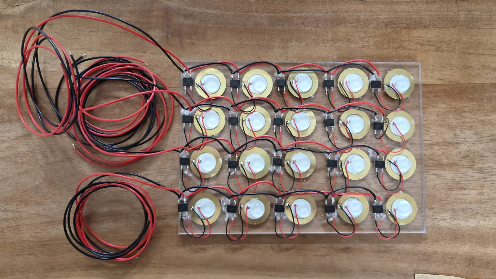
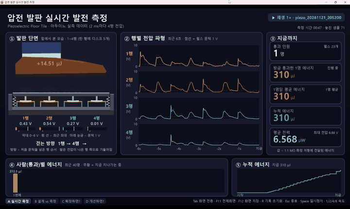
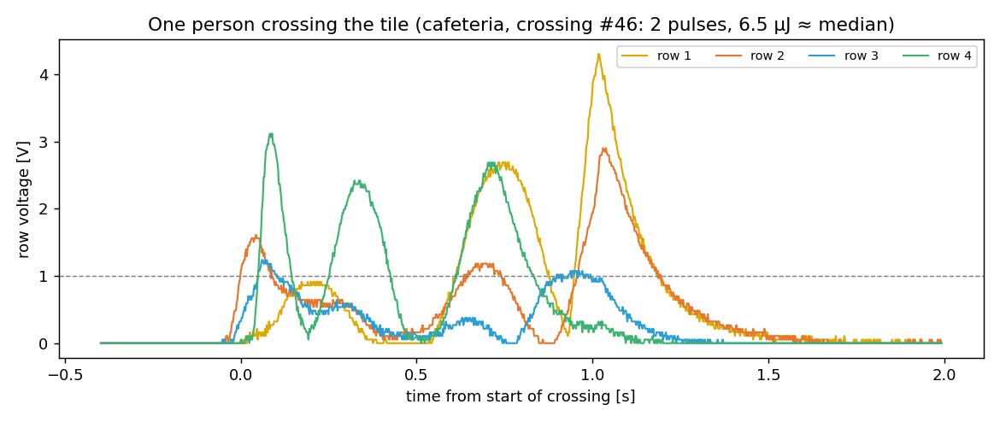
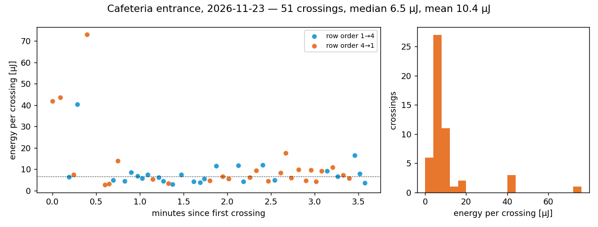

# piezo_hafs_108 — Can stepping on a floor tile make electricity?

**A high-school research project.** We measured one piezo disc, worked out why it gives so little energy, designed a
better material on paper, then built a 20-disc floor tile and measured it at our school's cafeteria entrance during lunch.

<p align="center">
  
  
</p>

<p align="center">
  <a href="https://kraewon7422.github.io/piezo_hafs_108/sim/PiezoAnalyzer_v2.html"></a>
  <a href="https://kraewon7422.github.io/piezo_hafs_108/sim/hafs108-crystal.html"></a>
</p>

> 🇰🇷 한국어 설명은 [아래](#한국어)에 있습니다.

---

## The story in eight steps

1. **The idea.** Some crystals make a voltage when squeezed (the *piezoelectric effect*). Hundreds of students pass the
   cafeteria entrance at the same time every day. Could piezo discs under that floor make useful electricity?
2. **One disc (Sept 11).**
   - We wired a 27 mm piezo disc straight to an Arduino (A0 and GND) and recorded it 62,000 times per second.
   - A hand press gave a pulse of **about 1.2 V lasting about 0.1 s**, holding only **about 15 nJ** (½·C·V², C ≈ 20 nF).
   - A hard tap made the disc ring at about 3.3 kHz.
3. **Why so little, and what matters.** A press lasts tens of milliseconds, hundreds of times slower than the disc's ring.
   - So resonance does not help a footstep. The disc just stores the charge the force makes.
   - Stored energy grows with **d × g** (charge per newton × voltage per unit charge) and with the square of the stress in the ceramic.
4. **Material on paper (Sept 18).** Ranking 11 published materials by d·g instead of d₃₃ changed the order.
   - We proposed a modified PZT composition that lowers the permittivity while keeping d.
   - We checked it for charge balance and the tolerance factor. It was **not made**, because it needs a ~1,200 °C furnace and lead handling.
5. **A 20-disc tile (Nov 13–19).** 4 rows × 5 discs.
   - One bridge rectifier per disc turns both the press and the release pulse into the same polarity.
   - The 5 discs of a row are in parallel, so the row has one voltage and the currents of discs pressed together add up.
   - Each row goes into its own protection and measuring circuit on a breadboard.
   - The design's stoppers were **not installed**.
6. **Preliminary sessions (Nov 21).** Stepping in place gave a median of **5.6 µJ per pulse** (191 pulses). The highest row voltage was 9.52 V with the 1.1 MΩ measuring load, not the "tens of volts" the design had assumed.
7. **At the cafeteria entrance (Nov 23, lunch, ~4 min).**
   - People walked across the tile while one of us counted them by hand: **50**. The tile counted **51** (totals within 2 %).
   - One crossing delivered a **median of 6.5 µJ** (mean 10.4 µJ) to the measuring resistor. The highest row voltage was 16.4 V.
8. **Conclusion.** Even before any storage losses, one IoT radio transmission (assumed 100 µJ) needs 10–15 crossings, and lighting a 20 mW LED for one second needs 1,900–3,100.
   - A piezo floor like ours is **not a practical power source** for a school.
   - It does reliably produce a signal for every person who walks across, so it **may work as a people counter**. A self-powered version has not been built.

---

## Key results

| measurement | value | in plain words |
|---|---|---|
| one disc, hand press (Sept 11) | **1.1–1.3 V, ≈ 0.1 s, ≈ 15 nJ** | open circuit, ½·C·V² of one disc |
| one disc, ringing after a hard tap | ≈ 3.3 kHz (1.13 V peak) | its resonance; a footstep is far slower |
| tile, stepping in place (Nov 21) | **median 5.6 µJ per pulse** (191 pulses) | energy into the 1.1 MΩ measuring resistor; steps not counted |
| tile, cafeteria entrance (Nov 23) | **median 6.5 µJ, mean 10.4 µJ per crossing** (51 crossings) | one crossing ≈ press + release ≈ one step |
| tile, people counted | **51 by the tile vs 50 by hand** | totals only; not matched one by one |
| tile, highest row voltage | 9.52 V (Nov 21), **16.4 V** (Nov 23) | with the 1.1 MΩ load; open-circuit voltage not measured |
| what it can power (upper bound) | 10–15 crossings per IoT transmission, 1,900–3,100 per LED-second | before rectifier/storage losses |

More detail, graphs and caveats: **[`tile_5x4/`](tile_5x4/)** for the tile, [`docs/00_piezo_basics.md`](docs/00_piezo_basics.md) (Korean) for the single disc.

| | |
|---|---|
|  |  |

---

## What is in this repository?

| if you want to… | open this |
|---|---|
| **see the built tile, its data and results** | [`tile_5x4/`](tile_5x4/) — photos, all recordings, results, analysis script |
| **understand the presentation GUI's code** | [GUI code walkthrough](tile_5x4/piezo_gui/CODE_WALKTHROUGH.md) (Korean) — how each screen turns serial lines into numbers |
| **understand piezo from zero** | [`docs/00_piezo_basics.md`](docs/00_piezo_basics.md) (Korean) |
| **read the material design** | [`docs/05_material_design.md`](docs/05_material_design.md) (Korean), [`calc/`](calc/), [`structures/`](structures/) |
| **play with the Sept 11 data in a browser** | [Data Analyzer v2](https://kraewon7422.github.io/piezo_hafs_108/sim/PiezoAnalyzer_v2.html) |
| **rotate the crystal in 3D** | [crystal page](https://kraewon7422.github.io/piezo_hafs_108/sim/hafs108-crystal.html) |
| **every Arduino sketch** | [`arduino/`](arduino/) (single disc, bench circuits) and [`tile_5x4/piezo_main/`](tile_5x4/piezo_main/) (the tile code actually run) |
| **build the tile** | [build diagrams](tile_5x4/README.md#build-diagrams) and the [assembly manual](tile_5x4/docs/assembly_manual_5x4_v2.html) (stoppers in the manual were not installed) |
| **the whole story, March → November** | [`docs/PROJECT_HISTORY.md`](docs/PROJECT_HISTORY.md) |
| **lab logs and the midterm report** | [`docs/logs/`](docs/logs/) — each file starts with an erratum box |
| **what the AI got wrong and how we checked** | [`docs/AI_FACT_CHECK.md`](docs/AI_FACT_CHECK.md) |

```
README.md
piezo_capture_simple.ino   ← sketch that recorded the single disc (Sept 11)
analyze_v2.py              ← Sept 11 recording → numbers + figures/
data/                      ← Sept 11 raw recording (CSV)
figures/                   ← Sept 11 graphs
arduino/                   ← later sketches: bench circuits A/B/C (designed, not run), first 5×4 draft
sim/                       ← browser tools: data analyzer, 3D crystal, illustrative material simulator, bench & wiring guides
calc/, structures/         ← material-design check script and crystal files (CIF)
tile_5x4/                  ← the 20-disc tile: code actually run, recordings, analysis, GUI, Jetson port, photos, manual
docs/                      ← basics, material design, history, logs, AI fact-check
```

## Reproduce

Python 3 with `numpy`, `matplotlib` (and `pygame`, `pyserial` for the GUI):

```bash
python analyze_v2.py                         # single disc, Sept 11
python calc/verify_composition.py            # proposed material: charge balance, tolerance factor, rankings
cd tile_5x4/analysis && python tile_results.py   # every tile number and figure (Nov 21 + Nov 23)
cd tile_5x4/piezo_gui && python piezo_gui_v1.py --replay ../piezo_main/piezo_20261123_134435/raw_serial.txt
```

A fresh clone reproduces `tile_5x4/analysis/results.md` exactly.

## Honesty notes

- **Measured vs assumed.**
  - Measured: the single disc (Sept 11), the tile sessions (Nov 21), and the cafeteria session (Nov 23).
  - Assumed: everything about a full day, a whole entrance, an IoT transmission or a commercial tile. These are labelled as assumptions where they appear.
  - Not measured: open-circuit voltage, the force on each disc, the best load resistance, and energy actually stored in a capacitor.
- **Limits of the cafeteria test.**
  - It is one ~4-minute session with one person counting.
  - Crossings were not time-matched one by one, and walking direction was not recorded by hand.
- **We publish our mistakes.** Withdrawn claims are listed in the erratum boxes of [`docs/logs/`](docs/logs/) and in [`docs/AI_FACT_CHECK.md`](docs/AI_FACT_CHECK.md). Examples:
  - a force calculation that used the wrong coefficient
  - an "LED lit up" result that was really powered by USB
  - simulator numbers that were relative, not real units
- **AI use.** We used Claude as a tutor and coding assistant (March–November 2026). On 2026-11-13 every AI chat of the project was re-checked against primary sources.

A 4-person student team did this project. License: [MIT](LICENSE).

---

## 한국어

**압전 발판을 밟으면 전기가 얼마나 나올까?** 고등학교 탐구 프로젝트입니다.
- 압전 디스크 한 개를 재서 전기가 왜 조금밖에 안 나오는지 알아보고, 소재를 종이 위에서 설계했습니다.
- 디스크 20개로 발판을 만들어 **점심시간 급식실 입구에서 실제로 측정**했습니다.

### 탐구의 흐름

1. **아이디어**: 같은 시간에 수백 명이 지나가는 급식실 입구 바닥에 압전 소자를 깔면 쓸 만한 전기가 나올까?
2. **디스크 한 개 (9월 11일)**
   - 27 mm 디스크를 아두이노 A0·GND에 바로 연결하고 1초에 62,000번 기록했습니다.
   - 손으로 누르면 **약 1.2 V, 0.1초** 펄스가 나왔고 에너지는 **약 15 nJ**이었습니다.
3. **왜 적은가**: 누르는 시간이 디스크의 울림(약 3.3 kHz)보다 수백 배 느려 공진을 쓸 수 없습니다.
   - 이때 저장되는 에너지는 **d × g**와 세라믹이 받는 응력의 제곱에 따라 정해집니다.
4. **소재 설계 (9월 18일)**
   - 문헌 소재 11종을 d₃₃ 대신 d·g로 비교하자 순위가 바뀌었습니다.
   - 유전율을 낮추는 PZT 조성을 제안하고 전하 균형·허용인자로 검증했습니다.
   - 학교에서 만들 수는 없어 **종이 위 설계**에 머뭅니다.
5. **5×4 발판 (11월 13~19일)**
   - **디스크마다 브리지 정류기**를 달아 누를 때와 뗄 때의 전압을 모두 같은 방향(직류)으로 바꿨습니다.
   - **행마다 5개를 병렬**로 묶었습니다. 행 전압은 하나로 같아지고, 동시에 눌린 디스크들의 전류는 더해집니다(증폭이 아니라 합).
   - 행마다 빵판의 보호·측정 회로에 연결했습니다.
   - **스토퍼는 달지 않았습니다.**
6. **예비 측정 (11월 21일)**
   - 제자리에서 밟았을 때 펄스당 에너지 중앙값은 **5.6 µJ**(191펄스)였습니다.
   - 측정 회로를 연결한 상태의 최대 행 전압은 9.52 V로, 설계에서 가정한 수십 V에 못 미쳤습니다.
7. **급식실 실측 (11월 23일 점심, 약 4분)**
   - 손으로 센 통과 **50회**, 발판이 센 통과 **51회**로 총수 차이는 2 %였습니다.
   - 통과 1회 에너지는 **중앙값 6.5 µJ**, 평균 10.4 µJ, 최대 행 전압은 16.4 V였습니다.
8. **결론**: 손실을 빼기 전 값으로도 IoT 무선 전송 1회(100 µJ 가정)에 10~15걸음, 20 mW LED 1초에 1,900~3,100걸음이 필요합니다.
   - 학교 **전력원으로는 비현실적**입니다.
   - 지나가는 사람마다 신호가 분명히 생기므로, **통행량 센서**로 쓸 가능성이 있습니다(전원 없이 동작하는 센서는 아직 만들지 않음).

### 무엇을 어디서 보나

| 하고 싶은 것 | 여기 |
|---|---|
| 만든 발판, 측정 원자료, 결과, 분석 스크립트, 사진 | [`tile_5x4/`](tile_5x4/) |
| 발표용 GUI가 숫자를 계산하는 방법 | [GUI 코드 해석](tile_5x4/piezo_gui/CODE_WALKTHROUGH.md) |
| 압전을 처음부터 이해하기 | [압전 기초론](docs/00_piezo_basics.md) |
| 소재 설계 | [`docs/05_material_design.md`](docs/05_material_design.md) |
| 9월 측정 데이터를 브라우저에서 보기 | [데이터 분석기 v2](https://kraewon7422.github.io/piezo_hafs_108/sim/PiezoAnalyzer_v2.html) |
| 아두이노 코드 | [`arduino/`](arduino/), 발판에 실제로 쓴 코드는 [`tile_5x4/piezo_main/`](tile_5x4/piezo_main/) |
| 발판 만드는 방법 | [제작 다이어그램](tile_5x4/README.md#build-diagrams), [조립 매뉴얼](tile_5x4/docs/assembly_manual_5x4_v2.html) (매뉴얼의 스토퍼는 실제로 달지 않음) |
| 3월부터 11월까지의 흐름 | [프로젝트 연혁](docs/PROJECT_HISTORY.md) |
| 연구 일지·중간보고서 (맨 위에 정오표) | [`docs/logs/`](docs/logs/) |
| AI가 틀린 것과 확인한 방법 | [AI 사실 확인](docs/AI_FACT_CHECK.md) |

### 정직하게 밝혀 두는 것

- **실측과 가정의 구분**
  - 실측: 9월 11일 디스크 1개, 11월 21일 예비 측정, 11월 23일 급식실 측정
  - 가정: 하루 전체·입구 전체·IoT 전송·상용 타일과의 비교는 모두 가정이며, 나오는 곳마다 가정이라고 적었습니다.
  - 아직 재지 않은 것: 개방 전압, 디스크에 실린 힘, 최적 부하, 커패시터에 실제로 모이는 에너지
- **급식실 측정의 한계**: 약 4분 한 번, 한 명이 손으로 셌고, 한 번씩 시각을 맞춰 대조하지 않았습니다. 걷는 방향도 손으로 기록하지 않았습니다.
- **틀린 것을 숨기지 않습니다.** 철회한 주장(잘못된 계수로 힘을 역산한 것, USB 전원으로 켜진 LED를 발전 증거로 본 것, 시뮬레이터의 상대값 등)은 각 일지의 정오표와 [AI 사실 확인](docs/AI_FACT_CHECK.md)에 있습니다.
- ⚠️ 디스크를 아두이노에 바로 연결한 상태에서는 **손으로만** 누르세요. 측정 저항을 단 상태에서도 밟을 때 16 V가 넘게 나왔으므로, 발 실험은 반드시 보호 회로를 거쳐야 합니다.

4명의 학생 팀이 진행했습니다. 라이선스: [MIT](LICENSE).
