# tile_5x4 — the 20-disc floor tile: built, tested, and measured at the cafeteria entrance

Timeline:
- **Nov 13:** tile designed.
- **Nov 19:** parts arrived and the tile was built.
- **Nov 21:** preliminary sessions (finger-press tests, stepping).
- **Nov 23:** recorded at the **school cafeteria entrance during lunch**, while people walked across the tile and the crossings were counted by hand.
- **Nov 26:** two more recordings at the entrance (5 min + 13 min) while first-year students walked to lunch.

This folder holds everything from that stage:
- the Arduino code that was actually run, and every recording
- a script that recomputes every number below
- a real-time GUI and its code walkthrough, and a Jetson port
- the assembly manual and photos

> 🇰🇷 한국어는 [아래](#한국어)에 있습니다.

<p align="center">
  
  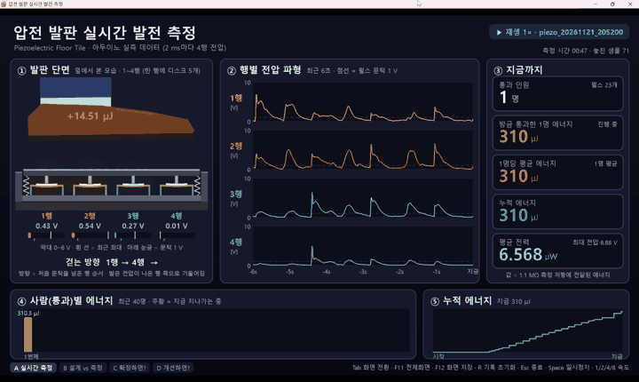
</p>

## How the tile is built (and why)

| part | what | why |
|---|---|---|
| discs | 20 × 27 mm piezo discs, 4 rows × 5, each with a transparent rubber bumper at its centre | the bumper passes the foot's force to the centre of the disc, where bending makes the most charge |
| rectifier | **one DB107S bridge rectifier per disc** | a disc gives a positive pulse when pressed and a negative one when released. The bridge turns both into the same polarity (AC → DC), so both halves count and the Arduino (0–5 V only) can read them |
| rows | the 5 rectified discs of a row are connected **in parallel** (WAGO connectors) → 4 row outputs | in parallel the row has one common voltage, and the currents of discs pressed at the same time **add up**. The bridges also stop charge from a pressed disc flowing back into an unpressed one. Four separate rows show *which row was hit first*, which gives the walking direction |
| top | clear acrylic top plate | spreads the foot over several discs |
| stoppers | **designed in the manual, not installed** | they would limit how far the plate can sink, to protect the ceramic. The tile was measured without them |
| measuring circuit (breadboard, one per row) | row → 1 MΩ → Arduino pin → 100 kΩ → GND (÷ 11), 1N4148 clamps to 0–5 V | ÷ 11 maps up to ~55 V onto the Arduino's 5 V input, because the design assumed stepping might give tens of volts. The clamps protect the pin |
| logging | Arduino Uno reads all 4 rows every 2 ms (`piezo_main.ino` v3.1) and detects pulses itself | see [`piezo_main/`](piezo_main/) |

- A ***pulse*** is one voltage burst: it starts when any row goes above 1 V, and ends when all rows stay below 0.3 V for 30 ms.
- A ***crossing*** (also called a *pass*) is a group of pulses less than 1 s apart, as grouped by `analyze.py`.
- **Energy** is the energy delivered to the 1.1 MΩ measuring resistor, Σ V²/R·Δt per row, summed over the 4 rows. It is **not energy stored for later use**: there is no storage capacitor in this circuit, and the bridge diodes (≈ 1–1.4 V for the pair) have already taken their share.

## Build diagrams

Drawn for the [assembly manual](docs/assembly_manual_5x4_v2.html) (Korean labels; full step-by-step text is in the manual).
The manual's stoppers (grey squares in the layout, posts in the cross-section) were **not installed** in the measured tile.

**Signal path** — disc → bridge rectifier → WAGO row bundle → row output → breadboard divider/protection → Arduino A0–A3 → laptop

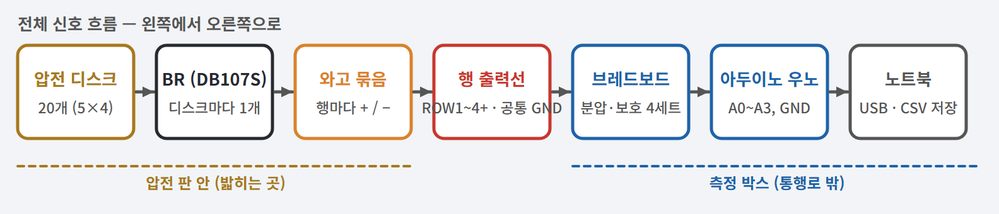

**Board layout** (50 × 40 cm example; row 1 = outer edge, row 4 = cafeteria side in the manual — the orientation on the measurement days was not recorded)

<p align="center">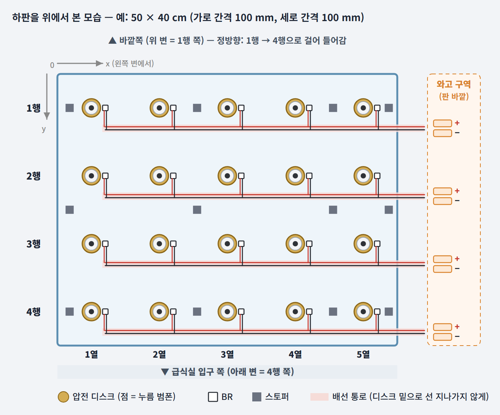</p>

**One disc and its bridge rectifier**

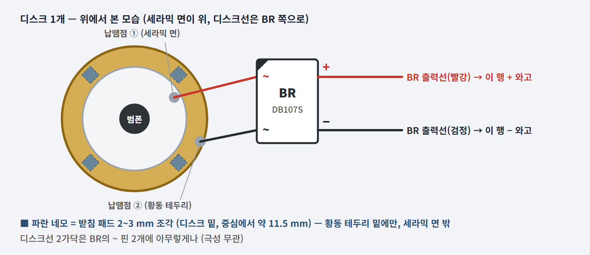

**Soldering a DB107S** (fix it on tape first, tin the pins, lay each wire on a pin, check and insulate)

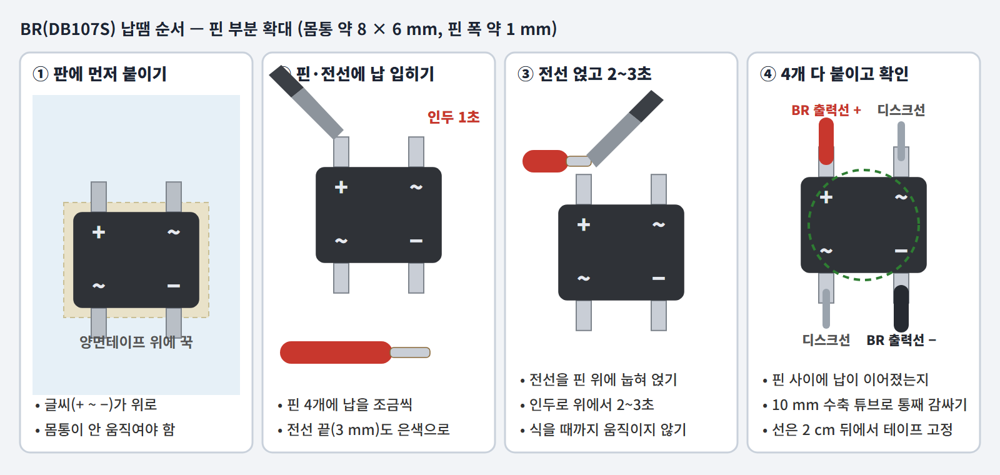

**One row in parallel** — the five BR "+" leads meet in WAGO connectors and leave as one row lead (the "−" side is wired the same way)

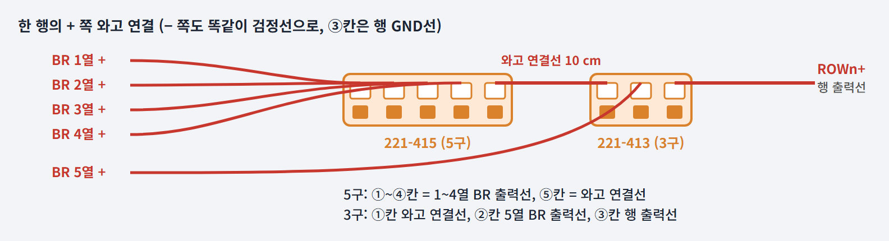

**Breadboard protection and measuring circuit** — per row: 1 MΩ in series, 100 kΩ to GND (÷ 11), two 1N4148 clamps to 0 V and 5 V; four identical channels

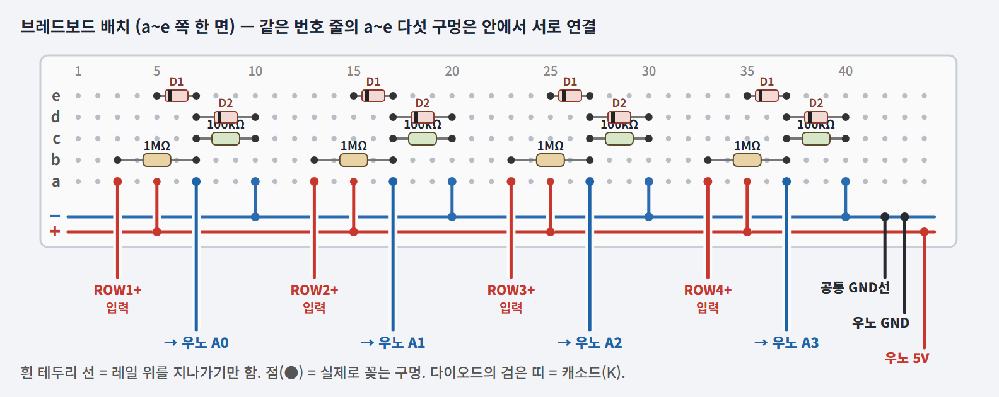

Real orientation on the desk, wired to the Uno:

<p align="center">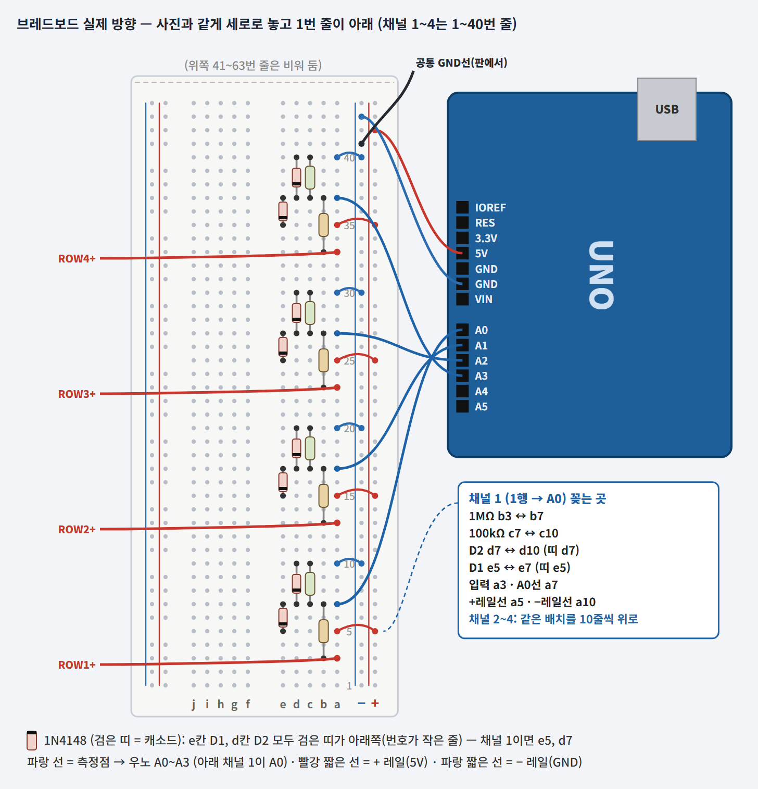</p>

**Cross-section as designed** — top plate resting on the rubber bumpers at the centre of each disc, discs on support pads under the brass rim. (Stoppers drawn here were not installed.)

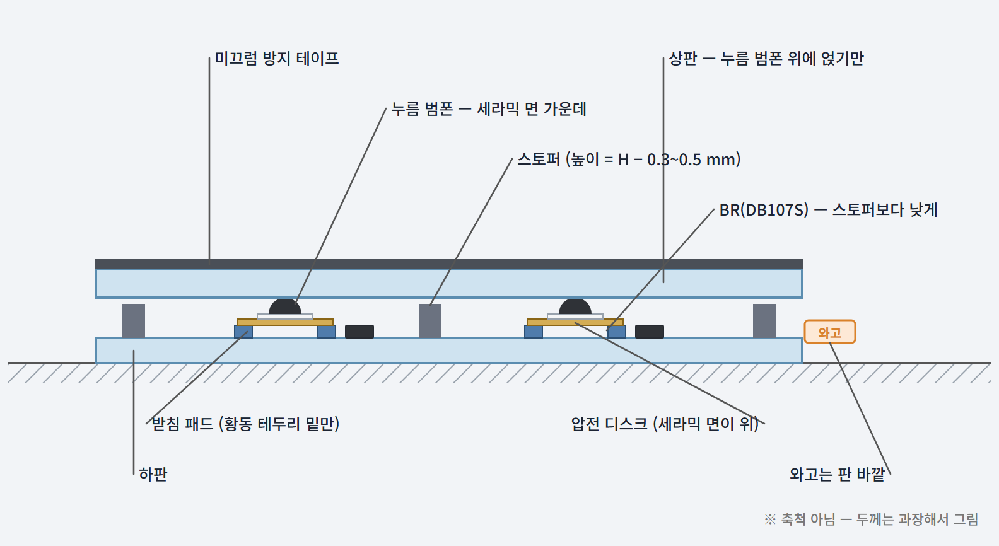

## 1. Preliminary sessions (Nov 21)

Two finger-press function tests (discs pressed one at a time) and three stepping sessions. What each session was is the
experimenter's record ([`piezo_main/DATA.md`](piezo_main/DATA.md)). Steps were **not** counted, so these are reported **per pulse**.

| session | what was done | pulses | peak row voltage, median / max | energy per pulse, median (µJ) | mean power while active |
|---|---|---|---|---|---|
| 19:28 | finger-press function test | 31 | 2.74 / 4.62 V | 0.790 | 1.35 µW |
| 20:12 | finger-press function test | 109 | 1.72 / 11.34 V | 0.228 | 0.36 µW |
| 20:23 | stepping | 87 | 4.68 / 9.52 V | 4.709 | 4.18 µW |
| 20:35 | stepping | 75 | 4.41 / 7.85 V | 5.502 | 4.61 µW |
| 20:52 | stepping | 29 | 5.81 / 8.06 V | 14.958 | 9.32 µW |

- **Stepping, all 3 sessions (191 pulses):**
  - energy per pulse: median **5.6 µJ** (middle half 3.9–10.5 µJ)
  - peak row voltage: median 4.7 V
  - in 90 % of pulses, 3–4 rows crossed 1 V together
- **Finger-press tests (140 pulses):** median 0.26 µJ.

| | |
|---|---|
|  | 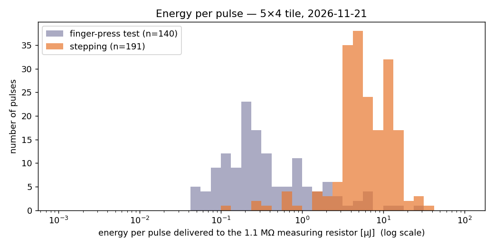 |
|  | 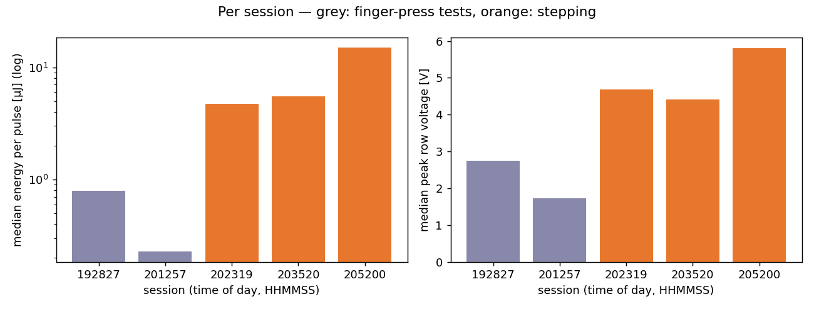 |

## 2. Cafeteria entrance at lunch (Nov 23) — the real-school test

The tile was placed in the cafeteria entrance passage at 13:44 and recorded for about 4 minutes while people walked across it.
At the same time, the crossings were counted by hand: **50**.
The 2-s noise baseline at the start stayed below 0.05 V, so the 60 Hz charger hum met earlier did not appear in this recording.

| quantity | value |
|---|---|
| crossings: counted by hand / counted by the tile | **50 / 51** (totals differ by +2 %) |
| pulses per crossing | 1.98 on average. 30 crossings had 2 pulses (press + release), 15 had 1, and 6 had 3 or more |
| energy per crossing | **median 6.5 µJ**, mean 10.4 µJ, middle half 4.6–9.5 µJ, max 72.9 µJ |
| in the 30 two-pulse crossings: first (press?) / second (release?) pulse, median | 2.3 µJ / 2.8 µJ |
| peak row voltage per pulse | median 4.19 V, **max 16.4 V** |
| pulses with ≥ 3 rows above 1 V | 88 % |
| energy share, rows 1 / 2 / 3 / 4 | 26 / 27 / 18 / 29 % |
| direction from row order (1→4 / 4→1) | 25 / 26 (not checked against a hand record) |
| crossings per minute | 14.2 |
| data quality | 96.6 % of 2-ms samples, 4 corrupted serial lines, 0 clipped pulses |

| | |
|---|---|
| 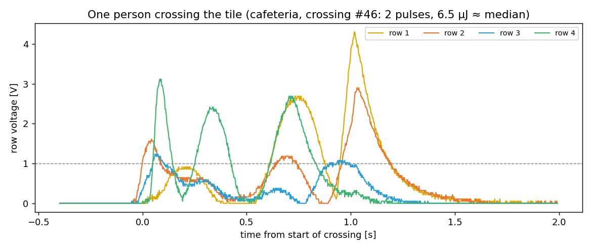 | 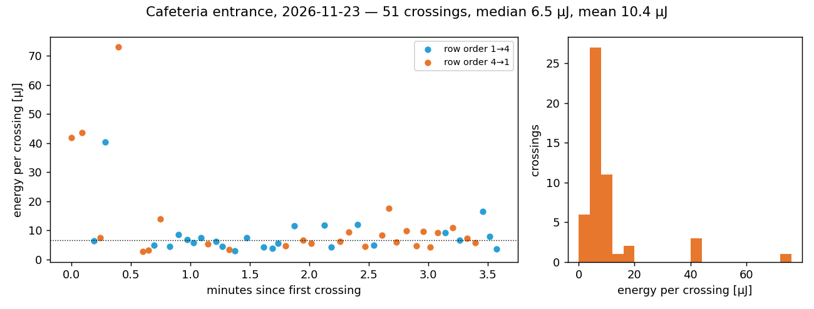 |

Left: a typical crossing (the one with energy closest to the median). The rows rise together when the foot lands and again when it lifts.
Without the bridges, the release half would be negative and invisible to the Arduino.
Right: all 51 crossings. Four of the first six (40–73 µJ) are long groups of 3–8 pulses lasting 4–11 s. They probably contain more
than one step or more than one person, and they pull the mean above the median.

## 3. Cafeteria entrance again (Nov 26) — first-year students walking to lunch

Two more recordings at the same entrance, while first-year students walked to lunch:
- **13:08, about 5 min** — 20 people counted by hand.
- **13:14, about 13 min** — the main run. People were **not** counted by hand; the 87 on the GUI is the tile's own count.

Everyone walked **one way, towards the cafeteria**. Which row faced the cafeteria was not written down.

| quantity | 11-23 13:44 | 11-26 13:08 | 11-26 13:14 |
|---|---|---|---|
| recording / raw-sample completeness | 3.8 min / 96.6 % | 4.8 min / 98.6 % | 13.3 min / 96.7 % |
| people counted by hand | 50 | 20 | not counted |
| crossings counted by the tile | 51 (+2 %) | 17 (−15 %) | 87 |
| crossings per minute | 14.2 | 4.9 | 7.0 |
| pulses per crossing | 1.98 | 1.88 | 2.68 |
| crossings with ≥ 5 pulses / longest crossing | 1 / 10.8 s | 1 / 11.1 s | **15 / 24.2 s** |
| energy per crossing, median / mean | 6.5 / 10.4 µJ | 8.0 / 28.6 µJ | **6.2 / 16.5 µJ** |
| share of all energy in the top 5 crossings | 41 % | 80 % | 36 % |
| peak row voltage, median / max | 4.19 / 16.4 V | 4.14 / **40.8 V** | 3.12 / 21.0 V |
| energy share rows 1/2/3/4 | 26/27/18/29 % | 40/25/15/20 % | 38/30/12/20 % |
| direction calls 1→4 / 4→1 / unknown | 25 / 26 / 0 | 3 / 12 / 2 | 27 / 48 / 12 |
| mean power over the recording | 2.34 µW | 1.69 µW | 1.80 µW |

All three recordings pooled: **155 crossings, median 6.6 µJ, mean 15.8 µJ** per crossing. No pulse was clipped.

| | |
|---|---|
| 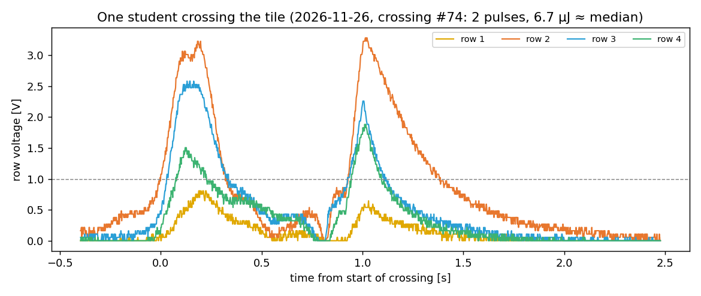 | 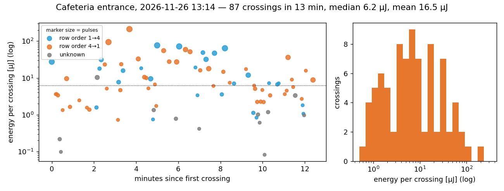 |

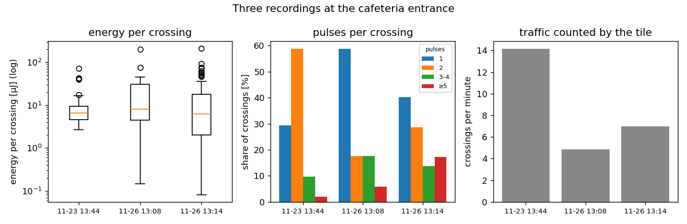

What we checked in these data:
- **The walking direction cannot be read reliably from the row order.** Everyone walked the same way, but the calls split: the majority call (4→1) was only 48 of 75 (64 %) at 13:14 and 12 of 15 (80 %) at 13:08. At best about two thirds of the calls are right. If row 1 faced the outside, as in the manual's example layout, most calls were wrong. On a rigid acrylic top the rows respond almost together, so "which row crossed 1 V first" mostly reflects where on the plate the foot landed.
- **Counting is not as good as the 11-23 result suggested.** At 13:08 the tile found 17 crossings for 20 people (−15 %). Crowding does not explain this: 11-23 was busier (14.2/min) and matched, while 13:08 (4.9/min) had only one crossing of 5 or more pulses. The cause is not determined. At 13:14, 15 crossings had 5 or more pulses and lasted up to 24 s; they may hold several students walking close together, or someone pausing on the tile. Without a hand count, the error of the 13:14 run is unknown.
- **The median energy per crossing is stable (6.2–8.0 µJ), the mean is not (10.4–28.6 µJ).** A few long crossings carry much of the energy (80 % in the top five at 13:08), so the median is the better "per person" number.
- **The highest voltage so far, 40.8 V,** came at 13:08 on row 1. The waveform rises and falls over many samples, so it is a real pulse. That is about 75 % of the 55 V input range, so the ÷ 11 divider was not oversized after all.

## 4. What these numbers do and do not say

- **Counting people works only roughly.**
  - 11-23: 51 crossings for 50 counted by hand (+2 %), totals only.
  - 11-26 13:08: 17 for 20 (−15 %); the cause is not determined (see §3).
  - The walking direction from row order was not reliable (see §3).
- **Walking across vs stepping in place.** Compared with the GUI's assumed design values (760 N, d_eff 11 nC/N; both assumptions):

  | | charge per pulse | peak voltage | energy | time to peak |
  |---|---|---|---|---|
  | cafeteria 11-23 | 30 % | 24 % | 6 % | 246 ms |
  | cafeteria 11-26 13:14 | 38 % | 18 % | 7 % | 386 ms |
  | stepping in place (11-21 20:52) | 72 % | 27 % | 17 % | 543 ms |

  - The press time of 543 ms is much longer than the circuit's RC time constant (1.1 MΩ × 100 nF per row ≈ 110 ms). So during long presses, charge leaks through the resistor before the voltage can build. This is consistent with the "circuit" share of the loss being larger there (×0.28 vs ×0.48).
  - At the cafeteria the press was short, but much less charge was produced in the first place.
  - Force on the discs was not measured, so these causes are interpretations, not measurements.
- **"Tens of volts" happened only once with the load connected.** The tile design assumed tens of volts. With the 1.1 MΩ load the highest row voltage was 9.52 V (11-21), 16.4 V (11-23) and 21.0 V (11-26 13:14); a single pulse reached 40.8 V (11-26 13:08). Typical pulses stayed at 3–5 V. The open-circuit voltage was not measured and may be higher.
- **How much electricity is that?** These values are the energy that reached the fixed 1.1 MΩ load. A better-matched load could take more; a real storage circuit would lose some to rectification, storage and conversion.

  | to do this | it takes |
  |---|---|
  | one IoT radio transmission (assumed 100 µJ) | 6–15 crossings (pooled mean 15.8 µJ to median 6.6 µJ) |
  | 20 mW LED for 1 s (0.02 J) | 1,300–3,000 crossings |

  The GUI's cafeteria scenario assumes 24 tiles (50 × 40 cm) in a 2 m × 2.4 m entrance, and 1,200 people × 3 meals × 4 steps = 14,400 steps per day. With the 11-26 mean (16.5 µJ) the GUI shows ~237 mJ per day (~2,400 transmissions, ~12 s of LED light). With the pooled median (6.6 µJ) it would be ~95 mJ.
  - The tile is **not a practical power source** under these conditions.
  - It might work as a **people counter** at the entrance. The Arduino and laptop were powered separately here, so a self-powered sensor has not been built.
- **Compared with the Sept 11 single disc (≈ 15 nJ per press):** that is ½·C·V² of one unloaded disc. The tile values are energy into a 1.1 MΩ resistor from 20 discs. They are different quantities and are not divided into each other.

## 4. The real-time GUI

[`piezo_gui/`](piezo_gui/) is the presentation program. It works with live serial input or replays a recording, on four screens (captures below replay the 11-26 13:14 run):
- **A** live measurement
- **B** design vs measured
- **C** scale-up
- **D** improvement calculator

**How every number on each screen is computed: [`piezo_gui/CODE_WALKTHROUGH.md`](piezo_gui/CODE_WALKTHROUGH.md)** (Korean, with captures).

| 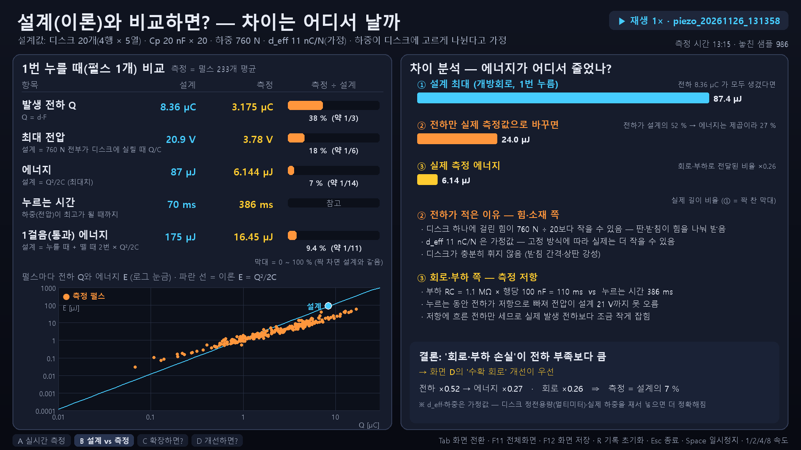 | 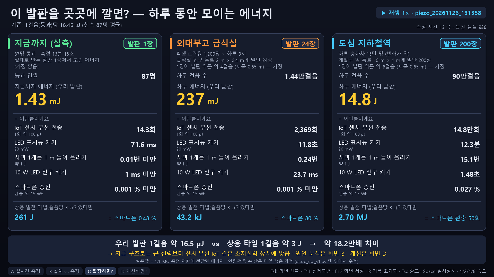 |
|---|---|

How to read the "per step" values:
- They count a group of pulses less than 1 s apart as one step.
- That is roughly right for the cafeteria, where one crossing ≈ one step, but long crossings (11-26) may hold more than one person.
- It is inflated for the 11-21 stepping-in-place sessions: in the 20:52 session, 29 pulses formed one group.

## Photos

| | | | |
|---|---|---|---|
| 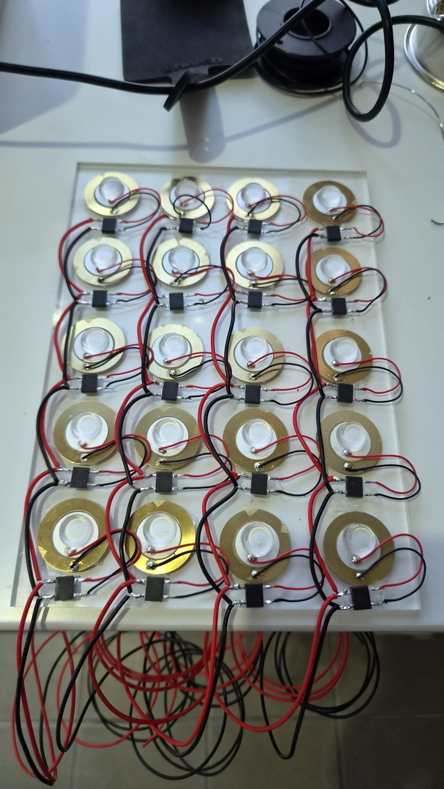 |  |  | 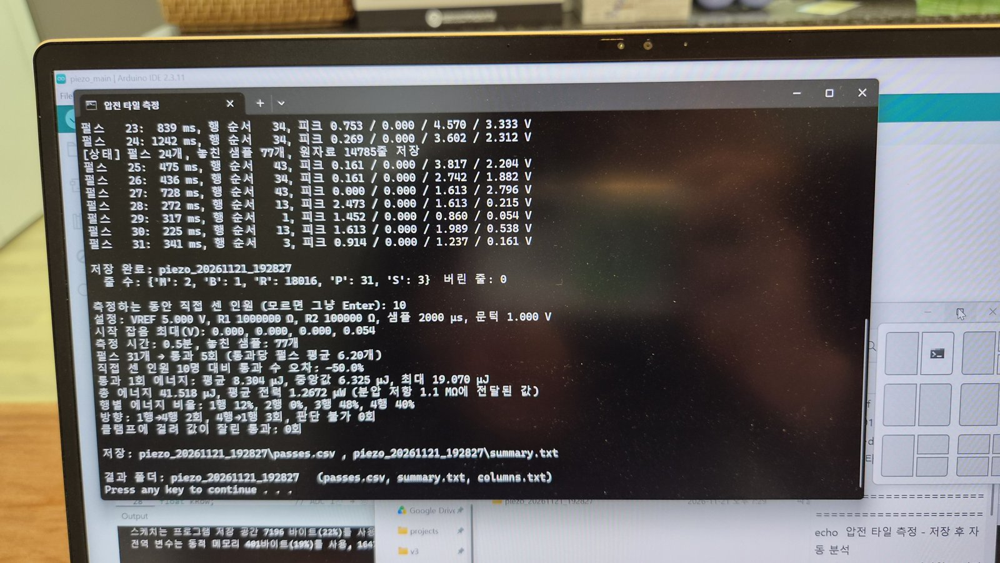 |
| discs, bumpers and bridge rectifiers being placed | 20 discs wired, 4 row leads | multimeter check | logger + analyze.py output of the 19:28 finger test |

Photos were resized and all metadata (including location) was removed before upload.

## Folder map

The layout copies the original working folder, so the relative paths inside the code still work.

```
tile_5x4/
  piezo_main/            ← Arduino sketch v3.1 actually used + logger.py + analyze.py + 측정_시작.bat
    DATA.md              ← what each session was, data quality, how to regenerate raw.csv
    piezo_2026xxxx_xxxx/ ← 8 sessions (raw_serial.txt = every line the Arduino sent)
  piezo_gui/             ← real-time GUI (Windows, pygame) + CODE_WALKTHROUGH.md + walkthrough/ captures
  piezo_jetson/          ← port for Jetson Orin Nano + AI starter kit (camera people count etc.) — NOT yet run on the hardware
  piezo_demo/            ← earlier draft sketch (storage-capacitor "E mode"); replaced by v3.1, never used for data
  piezo_sim/             ← circuit time-domain simulation that renders the vertical explainer video
  analysis/              ← tile_results.py → results.md + figures/
  figures/               ← graphs made by tile_results.py
  photos/                ← build and measurement photos
  docs/assembly_manual_5x4_v2.html  ← assembly manual (design incl. stoppers, which were not installed); numeric errors fixed 2026-11-22
  docs/plan_2026-05/     ← the May plan, kept as a record — several of its hypotheses were refuted by these measurements
```

## Reproduce

```bash
cd tile_5x4/analysis && python tile_results.py      # every number + figure above (numpy, matplotlib)
cd tile_5x4/piezo_gui && python piezo_gui_v1.py --replay ../piezo_main/piezo_20261126_131358/raw_serial.txt
cd tile_5x4/piezo_main && python logger.py --replay piezo_20261123_134435/raw_serial.txt   # rebuilds raw.csv etc. in a new folder
```

---

## 한국어

일정:
- **11월 13일:** 발판 설계
- **11월 19일:** 부품 도착, 제작
- **11월 21일:** 예비 측정(손가락 작동 시험, 밟기)
- **11월 23일:** **점심시간 급식실 입구**에서 사람들이 발판을 밟고 지나가는 동안 기록하고, 같은 시간 동안 통과 수를 손으로 셌습니다.
- **11월 26일:** 1학년 학생들이 점심을 먹으러 지나가는 동안 같은 입구에서 두 번 더 기록했습니다(약 5분 + 13분).

### 발판 구성과 그렇게 만든 이유

- **디스크 20개(4행 × 5열)**: 가운데마다 투명 고무 범폰을 붙여 발의 힘이 디스크 중앙으로 가게 했습니다.
- **디스크마다 브리지 정류기(DB107S)**
  - 디스크는 누를 때와 뗄 때 반대 방향 전압을 냅니다.
  - 정류기가 둘 다 같은 방향(교류 → 직류)으로 바꿔, 뗄 때의 전압까지 쓰고 0~5 V만 읽는 아두이노도 읽을 수 있게 합니다.
- **행마다 5개 병렬**(와고 커넥터)
  - 행 전압은 하나로 같아지고, 동시에 눌린 디스크들의 **전류가 더해집니다**. 처음엔 '증폭'이라고 생각했지만 정확히는 '합'입니다.
  - 정류기가 눌린 디스크의 전하가 안 눌린 디스크로 거꾸로 흐르는 것을 막습니다.
  - 4개 행을 따로 재기 때문에 어느 행이 먼저 눌렸는지로 걷는 방향을 추정합니다.
- **투명 아크릴 상판**을 얹었습니다. **매뉴얼의 스토퍼는 달지 않았습니다.**
- **행마다 빵판 측정 회로**
  - 1 MΩ → 아두이노 핀 → 100 kΩ → GND(÷ 11), 1N4148 보호
  - 발로 밟으면 수십 V가 나올 수 있다고 보고 약 55 V까지 재게 했습니다.
- **에너지**는 1.1 MΩ 측정 저항에 전달된 값입니다. 저장한 에너지가 아니며, 정류기의 손실(다이오드 2개, 약 1~1.4 V)을 이미 거친 값입니다.

### 1. 예비 측정 (11월 21일, 펄스 단위)

| 측정 | 무엇 | 펄스 | 최대 전압 중앙값 / 최대 | 펄스당 에너지 중앙값 | 활동 중 평균 전력 |
|---|---|---|---|---|---|
| 19:28 | 손가락 작동 시험 | 31 | 2.74 / 4.62 V | 0.790 µJ | 1.35 µW |
| 20:12 | 손가락 작동 시험 | 109 | 1.72 / 11.34 V | 0.228 µJ | 0.36 µW |
| 20:23 | 밟기 | 87 | 4.68 / 9.52 V | 4.709 µJ | 4.18 µW |
| 20:35 | 밟기 | 75 | 4.41 / 7.85 V | 5.502 µJ | 4.61 µW |
| 20:52 | 밟기 | 29 | 5.81 / 8.06 V | 14.958 µJ | 9.32 µW |

- **밟기 3회(191펄스)**: 펄스당 에너지 중앙값 5.6 µJ. 펄스의 90 %에서 3~4개 행이 함께 반응했습니다.
- **손가락 시험(140펄스)**: 중앙값 0.26 µJ.
- 걸음 수는 세지 않아 걸음당 값은 구하지 않았습니다.

### 2. 급식실 입구 실측 (11월 23일 13:44부터 약 4분)

- **손으로 센 통과 50회, 발판이 센 통과 51회**: 총수 차이는 2 %입니다.
  - 한 번씩 시각을 맞춰 대조하지는 않았습니다.
  - 행 순서로 추정한 방향 25 / 26회는 손 기록과 대조하지 않았습니다.
- **통과 1회 에너지**: 중앙값 **6.5 µJ**, 평균 10.4 µJ, 최대 72.9 µJ
  - 처음 6회 중 4회는 펄스 3~8개, 4~11초짜리 긴 묶음입니다. 여러 걸음이 섞였을 가능성이 커서 평균을 끌어올렸습니다.
- **통과당 펄스**: 평균 1.98개. 51회 중 30회가 누름·뗌 2개였습니다.
- **최대 행 전압**: 16.4 V(중앙값 4.19 V). 펄스의 88 %가 3개 행 이상에서 반응했습니다.
- **행별 에너지**: 26 / 27 / 18 / 29 %로 예비 측정보다 고르게 나왔습니다.
- 시작 2초 잡음 기준선이 0.05 V 이하라, 앞서 겪은 충전기 잡음은 이번 기록에 없었습니다.

### 3. 급식실 입구 재측정 (11월 26일, 1학년 점심)

- **13:08, 약 5분**: 지나간 사람을 손으로 세어 20명. 발판은 17회로 셌습니다(−15 %).
- **13:14, 약 13분(본 측정)**: 손으로 따로 세지 않았습니다. GUI의 87명은 발판이 센 수입니다.
- 학생들은 모두 **급식실 쪽 한 방향**으로 걸었습니다. 어느 행이 급식실 쪽이었는지는 기록하지 않았습니다.

| 항목 | 11-23 13:44 | 11-26 13:08 | 11-26 13:14 |
|---|---|---|---|
| 기록 시간 / 원자료 | 3.8분 / 96.6 % | 4.8분 / 98.6 % | 13.3분 / 96.7 % |
| 손으로 센 인원 / 발판이 센 통과 | 50 / 51 | 20 / 17 | 세지 않음 / 87 |
| 분당 통과 | 14.2 | 4.9 | 7.0 |
| 통과당 펄스 / 펄스 5개 이상인 통과 | 1.98 / 1회 | 1.88 / 1회 | 2.68 / **15회** |
| 통과 1회 에너지 중앙값 / 평균 | 6.5 / 10.4 µJ | 8.0 / 28.6 µJ | **6.2 / 16.5 µJ** |
| 최대 행 전압 중앙값 / 최대 | 4.19 / 16.4 V | 4.14 / **40.8 V** | 3.12 / 21.0 V |
| 방향 판정 1→4 / 4→1 / 판단 불가 | 25 / 26 / 0 | 3 / 12 / 2 | 27 / 48 / 12 |

- 세 기록을 합치면 통과 155회, 1회 에너지 **중앙값 6.6 µJ**, 평균 15.8 µJ입니다.
- **방향 판정은 믿기 어렵습니다.** 모두 한 방향으로 걸었는데도 판정이 갈렸습니다(13:14에 다수 판정 4→1이 75회 중 48회, 64 %).
- **계수 오차의 원인은 가려내지 못했습니다.** 11-23은 더 붐볐는데(분당 14.2회) 맞았고, 13:08은 한산했는데(분당 4.9회) −15 %였습니다. 13:14에는 펄스 5개 이상, 최대 24초짜리 통과가 15회 있었는데, 여러 명이 묶였을 수도 있고 누군가 발판 위에 서 있었을 수도 있습니다.
- **중앙값은 세 기록에서 비슷했고(6.2~8.0 µJ), 평균은 긴 묶음 몇 개 때문에 크게 달랐습니다(10.4~28.6 µJ).**
- **최대 전압 40.8 V**는 파형이 여러 샘플에 걸쳐 오르내린 진짜 펄스입니다. 측정 범위 55 V의 약 75 %입니다.

### 4. 해석과 한계

- **지나가기와 제자리 밟기의 비교** (GUI의 설계 가정 760 N, 11 nC/N 기준)
  - 급식실: 전하 30 %, 전압 24 %, 에너지 6 %, 최고점까지 246 ms
  - 20:52 제자리 밟기: 전하 72 %, 전압 27 %, 에너지 17 %, 최고점까지 543 ms
  - 11-26 13:14 급식실: 전하 38 %, 전압 18 %, 에너지 7 %, 최고점까지 386 ms
  - 누르는 시간이 측정 회로의 시정수(눌린 디스크 수에 따라 약 22~110 ms)보다 길어, 누르는 동안 전하가 저항으로 빠져나갑니다. 다만 손실의 크기가 누르는 시간 순서와 꼭 맞지는 않습니다.
  - 짧게 지나갈 때는 생긴 전하 자체가 적었던 것으로 **추정**합니다. 힘은 재지 않았습니다.
- **전기적 활용** (1.1 MΩ 측정 저항에 전달된 에너지 기준, 저장 손실은 빼지 않음)
  - IoT 무선 전송 1회(100 µJ 가정): 6~15걸음 (세 기록 합친 평균 15.8 µJ ~ 중앙값 6.6 µJ)
  - 20 mW LED 1초: 1,300~3,000걸음
  - GUI 급식실 가정(24장, 하루 14,400걸음): 11-26 평균 16.5 µJ이면 약 237 mJ(무선 전송 약 2,400회, LED 약 12초), 중앙값 6.6 µJ이면 약 95 mJ
  - 결론: 이번 조건에서 **전력원으로는 비현실적**입니다. 대신 **통행량 센서**로 쓸 가능성이 있습니다. 다만 이번에도 아두이노는 따로 전원을 썼습니다.
- **"수십 V" 가정**: 부하를 연결한 상태에서 대부분의 펄스는 3~5 V였고, 최대는 9.52 V(예비), 16.4 V(11-23), 40.8 V(11-26 13:08, 한 번)였습니다. 개방 전압은 재지 않았습니다.
- **추운 날의 오작동 (11월 24일, 원인 미확인)**
  - 업로드가 115200·117647·57600 모두에서 실패했습니다("expects OK byte 0x10 but got 0xfc"). 앞서 117647로 고친 설정이 그대로인데도 실패했습니다.
  - 측정 코드가 250000으로 보내는 줄도 깨져서 들어왔고, 시험 중 COM3가 한 번 사라졌다가 다시 잡혔습니다. 노트북은 배터리로 동작했습니다.
  - 온도를 재지 않아 연결선·단자 접촉, 압전 소자, 보드 자체 중 원인을 가려내지 못했습니다(습기도 떠올렸지만 확인하지 않았습니다). 겨울철 실외나 난방이 없는 곳에서의 동작은 보장할 수 없습니다.
  - 다음에 할 시험: 온도계를 두고 ① 타일 배선을 뽑고 보드만 ② USB 케이블·포트 교체 ③ 장치를 실온에 30분 둔 뒤, 순서대로 하나씩 바꿔 봅니다.

### 제작 다이어그램

조립 매뉴얼에 그린 그림을 [위의 Build diagrams](#build-diagrams)에 모았습니다: 전체 신호 흐름, 판 배치, 디스크와 정류기, 정류기 납땜, 와고로 행 병렬 연결, 빵판 보호·측정 회로, 단면도. 배치도와 단면도의 스토퍼는 실제로 달지 않았습니다.

### GUI와 코드 해석

화면 A~D가 아두이노의 줄을 어떤 식으로 숫자로 바꾸는지는 [`piezo_gui/CODE_WALKTHROUGH.md`](piezo_gui/CODE_WALKTHROUGH.md)에 있습니다.
- "걸음당" 값은 1초 안에 이어진 펄스를 한 묶음으로 셉니다.
- 급식실 기록에서는 대체로 맞지만, 11-26의 긴 묶음에는 여러 명이 들어 있을 수 있습니다.
- 제자리에서 계속 밟은 11-21 기록에서는 부풀려집니다.

### 재현

```bash
cd tile_5x4/analysis && python tile_results.py
cd tile_5x4/piezo_gui && python piezo_gui_v1.py --replay ../piezo_main/piezo_20261126_131358/raw_serial.txt
```

사진은 크기를 줄이고 위치 정보를 포함한 메타데이터를 모두 지운 뒤 올렸습니다.
