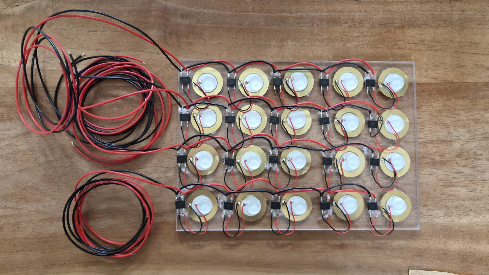
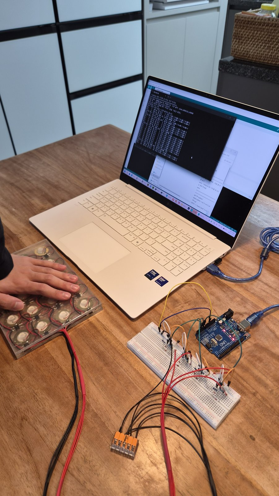
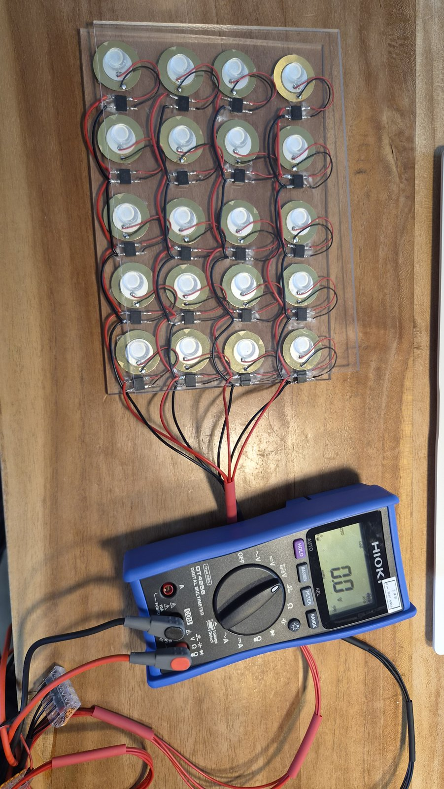
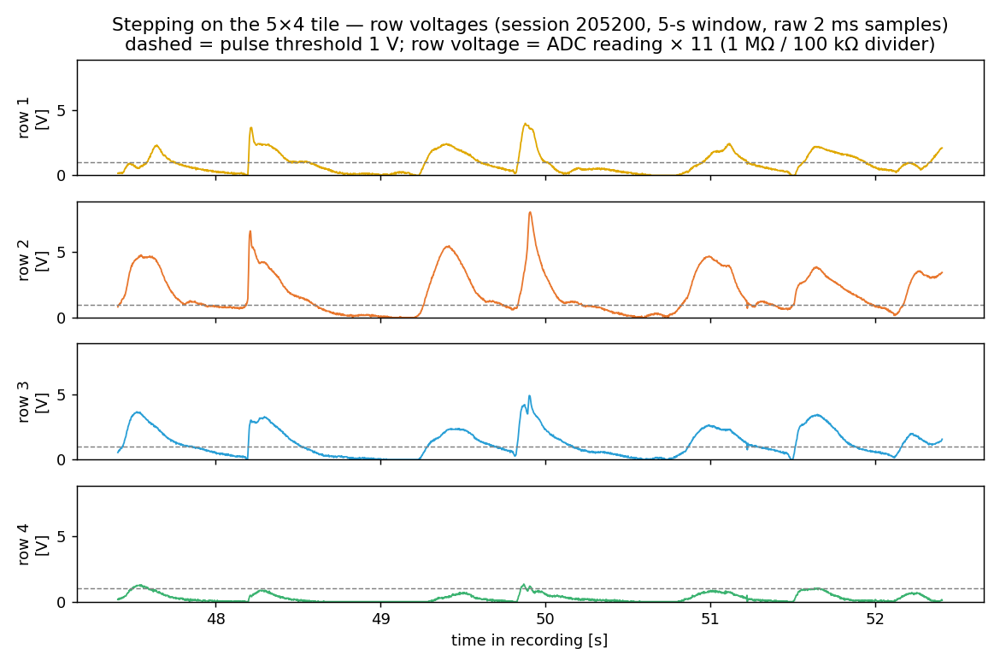
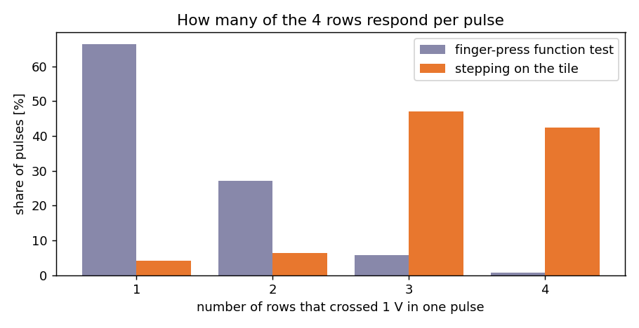
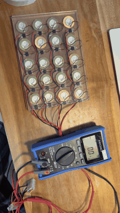
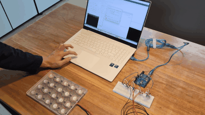
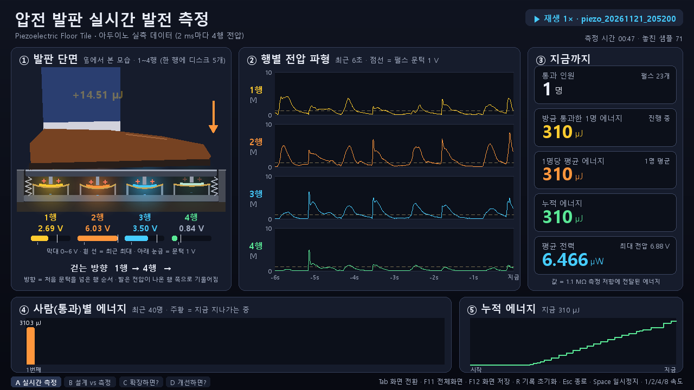

# tile_5x4 — the 20-disc floor tile, built and measured (2026-11-19 → 11-22)

The 5 × 4 tile designed on Nov 13 was built from the parts that arrived on Nov 19 and measured on **Nov 21, 2026**.
This folder holds everything from that stage: the Arduino code that was actually run, the recordings, a real-time GUI,
a Jetson port, the assembly manual, photos, and a script that recomputes every number below.

> 🇰🇷 한국어는 [아래](#한국어)에 있습니다.

<p align="center">
  
  
  
</p>

## What was measured — and what was not

| | |
|---|---|
| **Hardware** | 20 × 27 mm piezo discs (4 rows × 5), one DB107S bridge rectifier per disc, rows joined with WAGO connectors → 4 row outputs |
| **Measuring circuit** | each row → 1 MΩ → Arduino pin → 100 kΩ → GND (÷ 11), 1N4148 clamps; Arduino Uno samples all 4 rows every 2 ms |
| **Energy definition** | energy delivered to the 1.1 MΩ measuring resistor, Σ V²/R·Δt per row, summed over 4 rows. **This is not energy stored for later use** — there is no storage capacitor in this circuit |
| **Sessions kept** | 2 finger-press function tests + 3 stepping sessions (what each session was is stated by the experimenter, see [`piezo_main/DATA.md`](piezo_main/DATA.md)) |
| **Not recorded** | number of steps / people, who stepped, top-plate state. So this page reports values **per pulse**, not per step or per person |
| **Not done yet** | installation at the cafeteria entrance |

A *pulse* is one voltage burst detected by the Arduino (any row above 1 V until all rows stay below 0.3 V for 30 ms).

## Results (from [`analysis/results.md`](analysis/results.md), generated by [`analysis/tile_results.py`](analysis/tile_results.py))

| session | what was done | pulses | peak row voltage, median / max | energy per pulse, median (µJ) | mean power while active |
|---|---|---|---|---|---|
| 19:28 | finger-press function test | 31 | 2.74 / 4.62 V | 0.790 | 1.35 µW |
| 20:12 | finger-press function test | 109 | 1.72 / 11.34 V | 0.228 | 0.36 µW |
| 20:23 | stepping | 87 | 4.68 / 9.52 V | 4.709 | 4.18 µW |
| 20:35 | stepping | 75 | 4.41 / 7.85 V | 5.502 | 4.61 µW |
| 20:52 | stepping | 29 | 5.81 / 8.06 V | 14.958 | 9.32 µW |

*Mean power while active* = total energy ÷ (first pulse start → last pulse end) of that session.

**Pooled over the 3 stepping sessions (191 pulses):** energy per pulse median **5.6 µJ** (middle half 3.9–10.5 µJ),
largest single pulse 32 µJ; peak row voltage median 4.7 V; charge per pulse median 2.5 µC;
in **90 %** of pulses three or four rows crossed 1 V at once.
**Finger-press tests (140 pulses):** median 0.26 µJ; in 6 % of pulses ≥ 3 rows responded.



| | |
|---|---|
|  |  |


### What these numbers do and do not say

- **Data quality.** Every kept session has ≥ 95.9 % of the expected 2-ms samples, no clipped pulse
  (the measuring range ends at about 54 V) and 0–1 corrupted serial lines.
- **The "tens of volts" assumption.** The Nov 13 design assumed stepping would give tens of volts and chose a
  1 MΩ + 100 kΩ input for up to ~55 V. With this 1.1 MΩ load connected, the highest row voltage in any stepping pulse
  was 9.52 V. (Open-circuit voltage was not measured, so it may be higher.)
- **Finger vs stepping.** The median stepping pulse carried 21.7× the energy of the median finger-press pulse, and
  stepping usually excited 3–4 rows together. This is a comparison between two activities, not a controlled
  force experiment.
- **How small is it?** At the best session average (9.32 µW), keeping a 20 mW LED lit for one second
  (0.02 J) would take 0.02 J ÷ 9.32 µW ≈ **36 minutes** of continuous stepping — before any rectifier or storage losses.
- **Compared with the Sept 11 single disc (≈ 15 nJ per press):** that number was ½·C·V² of one disc pressed by hand
  with nothing connected; the tile numbers are energy into a 1.1 MΩ resistor from 20 discs. They are different
  quantities, so they are not divided into each other here.
- **Not claimed:** energy per step or per person (steps were not counted; the logger groups pulses that are less than
  1 s apart, and continuous stepping merges into a few long groups), harvesting efficiency, and cafeteria-scale totals.
  The GUI's scale-up screens use assumptions that are labelled as such on screen.

## Photos

| | | |
|---|---|---|
|  |  |  |
| discs and bridge rectifiers being placed | 20 discs wired, 4 row leads | multimeter check |
|  |  |  |
| logger + analyze.py output of the 19:28 finger test | Uno + breadboard protection circuit + laptop | pressing discs one by one (multimeter) |



Photos were resized and all metadata (including location) was removed before upload.

## Folder map

The layout copies the original working folder, so the relative paths inside the code still work.

```
tile_5x4/
  piezo_main/            ← Arduino sketch v3.1 actually used + logger.py + analyze.py + 측정_시작.bat
    DATA.md              ← what each session was, data quality, how to regenerate raw.csv
    piezo_2026xxxx_xxxx/ ← 5 kept sessions (raw_serial.txt = every line the Arduino sent)
  piezo_gui/             ← real-time GUI for presentations (Windows, pygame): live serial or replay
  piezo_jetson/          ← port for Jetson Orin Nano + AI starter kit (camera people count etc.) — NOT yet run on the hardware
  piezo_demo/            ← earlier draft sketch (storage-capacitor "E mode"); replaced by v3.1, never used for data
  piezo_sim/             ← circuit time-domain simulation that renders the vertical explainer video
  analysis/              ← tile_results.py → results.md + figures/
  figures/               ← graphs + a GUI screenshot made from the 20:52 stepping recording
  photos/                ← build and measurement photos
  docs/assembly_manual_5x4_v2.html  ← assembly manual, numeric errors fixed 2026-11-22 (list at the top of the page)
  docs/plan_2026-05/     ← the May plan, kept as a record — several of its hypotheses were refuted by these measurements
```

## Reproduce

```bash
cd tile_5x4/analysis && python tile_results.py                       # numbers + figures (numpy, matplotlib)
cd tile_5x4/piezo_gui && python piezo_gui_v1.py --replay ../piezo_main/piezo_20261121_205200/raw_serial.txt
cd tile_5x4/piezo_main && python logger.py --replay piezo_20261121_205200/raw_serial.txt   # rebuilds raw.csv etc. in a new folder
```

The GUI (screens: live / design vs measured / scale-up / improvements) — screenshot from the 20:52 stepping recording.
Its "per person" card groups pulses less than 1 s apart, so during continuous stepping one group contains many steps.
**How every number on each screen is computed (with captures from a screen recording):
[`piezo_gui/CODE_WALKTHROUGH.md`](piezo_gui/CODE_WALKTHROUGH.md)** (Korean).



---

## 한국어

11월 13일에 설계한 5 × 4 타일을 11월 19일 도착한 부품으로 만들고, **2026년 11월 21일**에 측정했습니다.
실제로 돌린 아두이노 코드, 측정 원자료, 실시간 GUI, 젯슨 버전, 조립 매뉴얼, 사진, 그리고 아래 숫자를 모두 다시 계산하는 스크립트가 있습니다.

### 무엇을 쟀고, 무엇을 안 쟀나

- **발판**: 27 mm 압전 디스크 20개(4행 × 5열), 디스크마다 브리지 정류기(DB107S), 행마다 와고로 묶어 출력 4가닥
- **측정 회로**: 행 → 1 MΩ → 아두이노 핀 → 100 kΩ → GND(÷ 11), 1N4148 보호. 2 ms마다 4행을 읽음
- **에너지의 뜻**: 1.1 MΩ 측정 저항에 전달된 에너지(Σ V²/R·Δt, 4행 합). **모아서 저장한 에너지가 아닙니다** — 이 회로에는 저장 커패시터가 없습니다
- **사용한 측정**: 손가락 작동 테스트 2개 + 실제 밟기 3개 (각 측정이 무엇이었는지는 실험자 기록 — [`piezo_main/DATA.md`](piezo_main/DATA.md))
- **기록하지 않은 것**: 걸음 수·사람 수, 상판 상태 → 그래서 **펄스(전압 덩어리 1개)당** 값만 씁니다
- **아직 안 한 것**: 급식실 입구 설치

### 결과 (분석 스크립트 출력 그대로)

| 측정 | 무엇 | 펄스 | 최대 전압 중앙값 / 최대 | 펄스당 에너지 중앙값 | 활동 중 평균 전력 |
|---|---|---|---|---|---|
| 19:28 | 손가락 작동 테스트 | 31 | 2.74 / 4.62 V | 0.790 µJ | 1.35 µW |
| 20:12 | 손가락 작동 테스트 | 109 | 1.72 / 11.34 V | 0.228 µJ | 0.36 µW |
| 20:23 | 밟기 | 87 | 4.68 / 9.52 V | 4.709 µJ | 4.18 µW |
| 20:35 | 밟기 | 75 | 4.41 / 7.85 V | 5.502 µJ | 4.61 µW |
| 20:52 | 밟기 | 29 | 5.81 / 8.06 V | 14.958 µJ | 9.32 µW |

- **밟기 3회 합계(191펄스)**: 펄스당 에너지 중앙값 **5.6 µJ**(가운데 절반 3.9–10.5 µJ), 가장 큰 펄스 32 µJ, 최대 전압 중앙값 4.7 V,
  펄스당 전하 중앙값 2.5 µC. 펄스의 **90 %**에서 3~4개 행이 동시에 1 V를 넘음
- **손가락 테스트(140펄스)**: 중앙값 0.26 µJ, 3개 행 이상 반응은 6 %

### 이 숫자가 말하는 것과 말하지 않는 것

- **데이터 품질**: 모든 측정이 원자료 95.9 % 이상, 잘린 값 0, 깨진 줄 0~1개
- **"발로 밟으면 수십 V" 가정**: 11/13 설계는 수십 V를 가정해 약 55 V까지 재는 입력을 만들었습니다. 1.1 MΩ 부하를 단 상태에서 밟기 펄스의 최대 전압은 **9.52 V**였습니다(부하 없는 개방전압은 재지 않았으므로 더 높을 수 있음)
- **손가락 vs 밟기**: 밟기 펄스의 에너지 중앙값이 손가락의 21.7배였고, 밟기는 대부분 3~4행을 함께 울렸습니다. 두 활동의 비교이지, 힘을 통제한 실험은 아닙니다
- **얼마나 작은가**: 가장 큰 측정 평균(9.32 µW)으로 20 mW LED를 1초 켜려면(0.02 J) 0.02 J ÷ 9.32 µW ≈ **36분** 동안 계속 밟아야 합니다(정류·저장 손실 전)
- **9월 11일 디스크 1개(약 15 nJ)와 비교하지 않는 이유**: 그 값은 아무것도 연결하지 않은 디스크 1개의 ½·C·V²이고, 타일 값은 디스크 20개가 1.1 MΩ 저항에 준 에너지라 서로 다른 양입니다
- **주장하지 않는 것**: 걸음당·사람당 에너지(걸음을 세지 않았고, 1초 안에 이어진 펄스는 한 묶음이 되어 계속 밟으면 여러 걸음이 한 묶음이 됨), 수확 효율, 급식실 규모 총량. GUI의 확장·개선 화면은 화면에 "가정"으로 표시된 값을 씁니다

### GUI 코드 해석

화면 A~D가 아두이노의 줄을 받아 어떤 식으로 숫자를 만드는지, 녹화 화면을 잘라 붙여 설명했습니다 →
[`piezo_gui/CODE_WALKTHROUGH.md`](piezo_gui/CODE_WALKTHROUGH.md).
GUI의 "1명당·1걸음" 값은 1초 안에 이어진 펄스를 한 묶음으로 세기 때문에, 계속 밟은 측정에서는 크게 부풀려집니다(해석 문서 4절).

### 재현

```bash
cd tile_5x4/analysis && python tile_results.py
cd tile_5x4/piezo_gui && python piezo_gui_v1.py --replay ../piezo_main/piezo_20261121_205200/raw_serial.txt
```

사진은 크기를 줄이고 위치 정보를 포함한 메타데이터를 모두 지운 뒤 올렸습니다.
