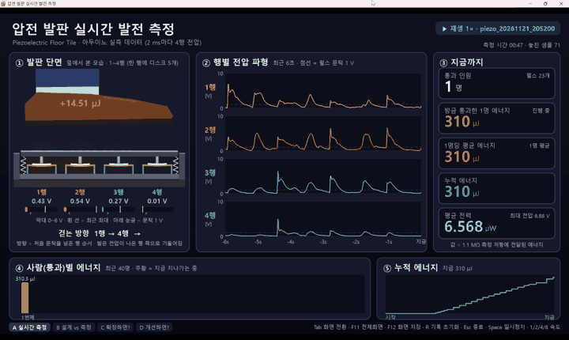
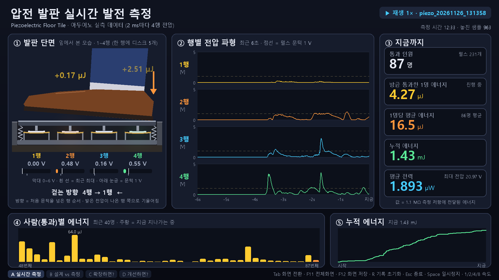
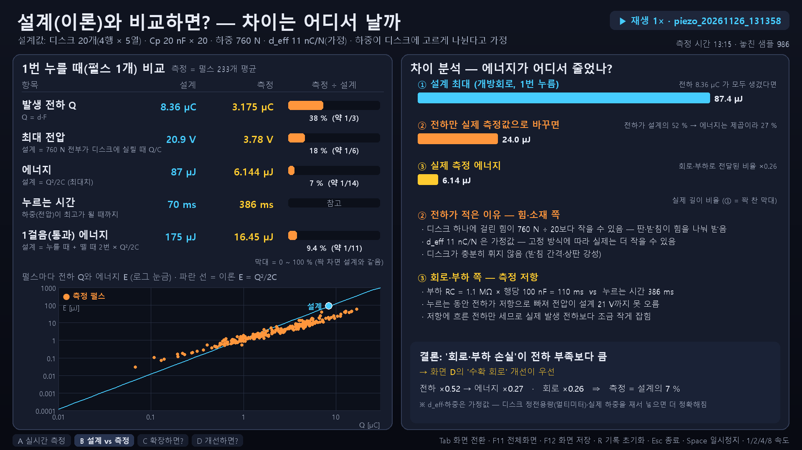
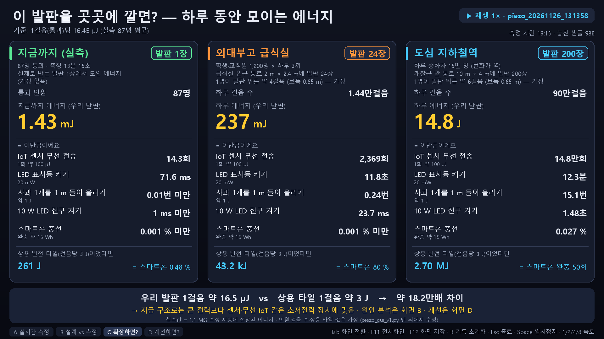
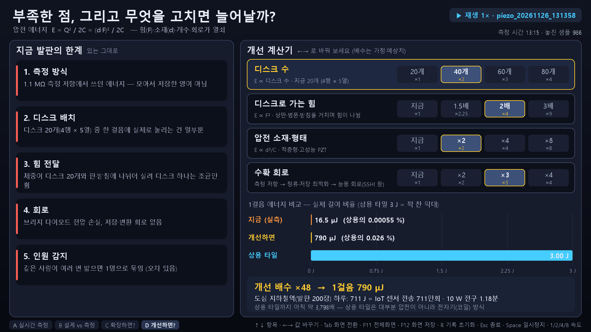

# GUI 코드 해석 — 화면마다 무엇을 어떻게 계산하나

`piezo_gui_v1.py`(Windows)와 `../piezo_jetson/piezo_jetson_v1.py`(젯슨)가 보여 주는 숫자가 **어디서 오고 어떤 식으로 계산되는지** 화면별로 설명한다.

- 움직이는 화면 A는 2026-11-22 화면 녹화(11-21 20:52 밟기 측정 재생)에서 잘라 냈다.
- 나머지 캡처는 2026-11-26 급식실 본 측정(`piezo_20261126_131358`, 1학년 점심, 약 13분)을 `--replay … --snapshot` 으로 재생해 저장했다. 화면 A는 마지막 통과(87번째) 도중, 화면 B~D는 기록이 끝난 시점이다.

> *English summary:* how each screen of the presentation GUI turns the Arduino's serial lines into numbers. Screen captures replay the
> cafeteria main run of 2026-11-26 (13:14, 87 crossings), where one crossing ≈ one step for most people, so the "per step" numbers are roughly meaningful there. **Read §4:** during
> continuous stepping on the tile (the 11-21 sessions) pulses less than 1 s apart merge into one group and the "per step" numbers are inflated.

---

## 1. 데이터가 흐르는 길

```
아두이노 (piezo_main.ino v3.1, 2 ms마다 4행 측정)
  │  시리얼 250000 baud, 한 줄씩:  M(설정) · B(잡음 기준선) · R(원자료) · P(펄스 요약) · S(10초 상태)
  ▼
SerialSource (실시간)  또는  ReplaySource (저장된 raw_serial.txt 재생)     ← 별도 스레드
  │  logger.py 의 parse_line·Writer 를 그대로 사용 → 실시간이면 logger.py 와 같은 측정 폴더도 저장
  ▼  queue
State.feed()      줄 종류별로 값 정리 (행 전압, 펄스, 통과 묶음, 누적 에너지)
  ▼
UI.draw()         화면 A~D 그리기 (1920×1080 기준 좌표 × 창 배율, 줄이지 않고 실제 해상도로 그림)
```

- **펄스는 아두이노가 판정한다**(`piezo_main.ino`).
  - 어느 행이든 1.0 V를 넘으면 펄스가 시작된다.
  - 모든 행이 0.3 V 아래로 30 ms 동안 머물면 끝나고, 3초를 넘으면 강제로 끝낸다.
  - 펄스 동안 행마다 아래 두 값을 2 ms마다 더해 P 줄로 보낸다.
    - 에너지 E = Σ V²/R × Δt (R = 1 MΩ + 100 kΩ, V는 시작 2초 잡음 기준선을 뺀 행 전압)
    - 전하 Q = Σ V/R × Δt
- **GUI는 이 값을 다시 계산하지 않고 받아서 정리만 한다.** 그래서 GUI 숫자와 `analyze.py`·`tile_results.py`의 숫자가 같다(측정 전체를 재생해 펄스 수와 에너지 합이 일치하는 것을 확인함).
- 행 전압 = ADC 값 × VREF ÷ 1023 × (R1 + R2) ÷ R2. M 줄의 VREF·R1·R2로 계산한다(`State._feed`, kind == "M").
- 우노가 재시작해 시간이 처음부터 다시 시작해도 그래프가 끊기지 않게, 세션 시간에 차이를 더해 이어 붙인다(`State._st`).

## 2. 화면별 설명

### 화면 A — 실시간 측정





| 영역 | 무엇을 보여 주나 | 코드 |
|---|---|---|
| ① 발판 단면 | 디스크 4개 = 1~4행. 각 디스크는 그 행 전압만큼 빛나고 휜다. 발은 전압이 큰 행 쪽으로 기울어져 그쪽이 먼저 닿는다 | `UI.tile`, `UI.shoe`. 밝기는 행 전압 포락선(220 ms로 서서히 줄어듦, `State.update`), 기울기는 행 전압 가중 평균 위치 |
| ② 행별 전압 파형 | 최근 6초, 2 ms 원자료. 화면 한 칸(픽셀)마다 그 구간의 최댓값을 그려 짧은 봉우리도 놓치지 않는다. 점선 = 펄스 문턱 1 V | `UI.waves` (`np.maximum.at`) |
| ③ 지금까지 | 통과 수, 방금 통과한 묶음 에너지, 묶음 평균, 누적 에너지, 평균 전력, 최대 전압 | `UI.cards` |
| ④ 통과별 에너지 | 최근 40개 묶음의 에너지 막대 (주황 = 지금 진행 중) | `UI.pass_bars` |
| ⑤ 누적 에너지 | P 줄이 올 때마다 계단처럼 늘어나는 합 | `UI.cum_graph` |

"통과(묶음)"는 `analyze.py`와 같은 규칙이다: 펄스 사이 간격이 1초 이하이면 같은 묶음이다.
- P 줄은 펄스가 **끝난 뒤** 온다.
- 그래서 묶음은 마지막 펄스 뒤 1초에 최대 펄스 길이 3초를 더 기다린 뒤 닫는다(`State.update`).
- 이렇게 하지 않으면 다음 펄스를 새 사람으로 센다.

### 화면 B — 설계(가정)와 비교



설계값은 실제 발판(디스크 20개, 1개당 20 nF)과 `piezo_sim.py`의 가정(하중 760 N, 유효 압전계수 11 nC/N)으로 계산한다(`UI.draw_theory`).

| 줄 | 설계 계산 | 측정 | 급식실 (11-23) | 급식실 (11-26 13:14) | 계속 밟기 (11-21 20:52) |
|---|---|---|---|---|---|
| 발생 전하 | Q = d·F = 11 nC/N × 760 N = 8.36 µC | 펄스마다 4행 Q 합의 평균 | 2.486 µC (30 %) | 3.175 µC (38 %) | 5.996 µC (72 %) |
| 최대 전압 | V = Q / C = 8.36 µC ÷ 400 nF = 20.9 V | 펄스마다 가장 큰 행 전압의 평균 | 4.99 V (24 %) | 3.78 V (18 %) | 5.70 V (27 %) |
| 에너지 | E = Q² / 2C = 87 µJ | 펄스마다 4행 E 합의 평균 | 5.255 µJ (6 %) | 6.144 µJ (7 %) | 14.758 µJ (17 %) |
| 누르는 시간 | 70 ms (시뮬레이션 가정) | 행이 문턱을 넘은 뒤 최고점까지 걸린 시간의 평균 | 246 ms | 386 ms | 543 ms |
| 1걸음(통과) | 누름 + 뗌 2번 × Q²/2C = 175 µJ | 묶음 평균 (§4) | 10.41 µJ | 16.45 µJ | 427.97 µJ (부풀려짐) |

오른쪽 "차이 분석"은 에너지가 줄어든 것을 두 몫으로 나눈다.
1. 설계 최대에서 시작한다.
2. 전하만 측정값으로 바꾼 값을 계산한다: E_q = E_설계 × 평균(Q_측정²) / Q_설계². 에너지는 전하의 제곱에 비례하므로 이 몫은 "전하가 적게 생겨서" 줄어든 부분이다. 그래서 오른쪽에 적힌 "전하가 설계의 ○ %"는 **제곱평균(RMS) 전하** 기준이라 왼쪽 표의 평균 전하 비율보다 크다(11-26: 왼쪽 38 %, 오른쪽 52 %).
3. 실제 측정 에너지와 비교한다. ③ ÷ ②는 "생긴 전하가 회로·부하로 전달된 비율"이다.

두 측정을 비교하면 다음과 같다.
- **급식실:** 전하 ×0.35 → 에너지 ×0.13, 회로 ×0.48. 화면은 주된 원인을 "전하 부족"으로 판정했다. 사람이 짧게(246 ms) 밟고 지나가 저항으로 빠져나간 몫은 상대적으로 작았지만, 생긴 전하 자체가 적었다.
- **급식실 11-26 13:14:** 전하(RMS) ×0.52 → 에너지 ×0.27, 회로 ×0.26. 화면은 "회로·부하 손실이 더 크다"고 판정했다. 누르는 시간이 386 ms로 11-23(246 ms)보다 길었다. 붐벼서 여러 명이 한 펄스에 섞였을 수도 있다.
- **계속 밟기(20:52):** 회로 ×0.28로 회로·부하 손실이 더 컸다. 부하 RC(1.1 MΩ × 행당 100 nF = 110 ms)가 누르는 시간(543 ms)보다 훨씬 짧아, 누르는 동안 전하가 저항으로 빠져 전압이 오르지 못한 것과 맞는다.

**설계값의 하중과 압전계수는 가정이다.** 그래서 이 비율은 실제 손실의 크기라기보다 측정끼리 비교하는 데 의미가 있다.

### 화면 C — 확장하면?



- 발판 장수와 걸음 수는 `scenario_numbers()`가 계산한다.
  - 장수 = ⌈통로 폭 ÷ 0.5 m⌉ × ⌈통로 길이 ÷ 0.4 m⌉. 급식실 입구 2 m × 2.4 m이면 4 × 6 = 24장이다.
  - 1명당 걸음 = 통로 길이 ÷ 보폭 0.65 m.
- 하루 에너지 = 하루 걸음 × "1걸음 에너지"다. 11-26 측정이면 16.45 µJ × 14,400걸음 ≈ 237 mJ이다(11-23 측정이면 10.41 µJ로 약 150 mJ).
- 오른쪽 숫자는 그 에너지를 IoT 전송(1회 100 µJ), LED, 스마트폰 충전 등으로 나눈 값이다(`fmt_unit`).
- **인원, 통로 크기, 보폭, 상용 타일 3 J는 모두 가정이다.** 바꾸려면 `piezo_gui_v1.py` 맨 위를 고친다.
- 평균 16.45 µJ는 긴 묶음 몇 개 때문에 중앙값(6.2 µJ)보다 훨씬 크다. 중앙값으로 계산하면 하루 약 89 mJ이다. 1.1 MΩ 측정 저항에 전달된 에너지 기준이며 정류·저장 손실은 빼지 않았다.

### 화면 D — 부족한 점과 개선 계산기



- 왼쪽은 한계 목록, 오른쪽은 계산기다.
- 항목마다 고른 배수를 모두 곱해 "개선 배수"를 만든다(`UI.lever_factor`).
  - 디스크 수: E ∝ 개수
  - 디스크로 가는 힘: E ∝ F²(1.5배 → 2.25배). 힘은 상판·고무 범폰·받침을 거치며 나뉜다.
  - 소재·회로: 고른 배수 그대로
- 막대는 상용 타일 3 J를 꽉 찬 막대로 둔 **선형 길이**다.
- **배수는 예상치일 뿐, 실험으로 확인한 값이 아니다.**

## 3. 젯슨 버전에서 더해진 것

`../piezo_jetson/`은 화면 A~D를 그대로 가져다 쓰고(`import piezo_gui_v1`), 두 가지를 더한다.
- 화면 E: 발판·카메라·초음파로 센 사람 수를 비교한다.
  - 카메라 사람 수는 노란 선을 넘은 중심점 수다(`LineCounter`, 선 주변 ±4 %는 판단 보류).
  - 초음파는 평소 거리보다 30 cm 가까워진 순간을 센다.
- "개인 프라이버시를 위해 영상은 저장하지 않습니다!" 띠.

**젯슨·키트 실물에서는 아직 시험하지 않았다.**

## 4. ⚠️ 숫자를 읽을 때 주의할 점

GUI의 **"통과", "1명당", "1걸음(통과)"** 은 모두 *1초 안에 이어진 펄스 묶음*을 한 단위로 센다.

- **급식실처럼 사람이 발판을 한 번 지나가는 경우**(원래 설계 의도): 11-23에는 통과 51회 중 30회가 누름·뗌 펄스 2개였고 평균 1.98펄스였다. 그래서 묶음 1개를 1걸음으로 볼 수 있다. 손으로 센 50회와 총수도 2 % 차이였다(한 번씩 시각을 맞춰 대조하지는 않았다).
- **11-26 기록**: 13:14 기록에는 펄스 5개 이상, 최대 24초짜리 묶음이 15개 있었다. 학생들이 줄지어 지나가 여러 사람의 펄스가 1초 안에 이어졌을 수도 있고, 누군가 발판 위에 서 있었을 수도 있다(손으로 세지 않아 알 수 없음). 13:08 기록은 손으로 센 20명에 대해 17회(−15 %)였는데, 그 기록에는 긴 묶음이 1개뿐이어서 묶임만으로는 설명되지 않는다. 화면의 "통과 인원"은 실제 인원과 다를 수 있다.
- **11-21 예비 측정처럼 발판 위에서 계속 밟는 경우**: 여러 걸음이 한 묶음이 된다. 20:52 측정은 펄스 29개가 한 묶음이어서 걸음당 값이 크게 부풀려졌다.

| 화면 | 20:52 녹화에 보이는 값 | 실제 의미 | 펄스 기준으로 다시 보면 |
|---|---|---|---|
| A ③ | 통과 1회, 1명당 428 µJ | 펄스 29개의 합 | 펄스당 평균 14.76 µJ |
| B 1걸음 줄 | 427.97 µJ | 묶음 1개 = 29펄스의 합 | 한 걸음을 펄스 2개로 보면 약 30 µJ (가정) |
| C 전체 | 1걸음 428 µJ로 하루 값을 계산 | 부풀린 값을 걸음 수에 곱한 것 | 같은 가정이면 하루 값은 약 1/14 |

그래서 예비 측정은 펄스당 값으로만 정리했고(`../analysis/results.md`), 걸음(통과)당 값은 급식실 측정에서만 구했다.
화면 B의 위 세 줄(전하·전압·에너지)과 차이 분석은 펄스당 평균이라 이 문제가 없다.
